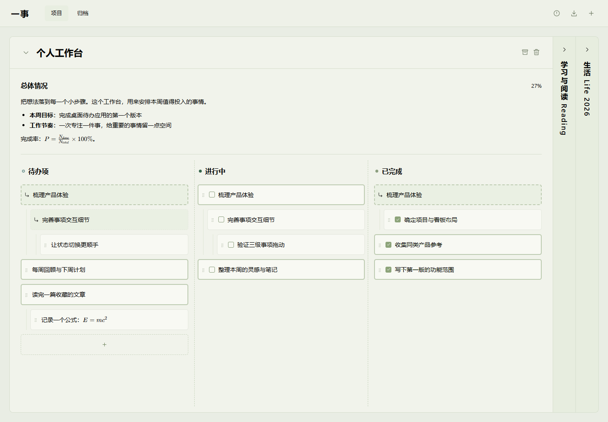

# 一事 · 桌面待办

面向 Windows 的本地待办工作台，用「待办项 → 进行中 → 已完成」三列整理项目和三级事项。基于 Tauri 2，数据由 Rust 直接保存到本机，无需账号或后台服务，Markdown 与 LaTeX 资源随程序离线分发。

## 界面预览



## 功能

- **项目管理**：新建、重命名、拖动排序、归档与删除；同时展开一个项目，其余项目以竖向标题显示。
- **三级事项**：连续输入、调整层级、拖动排序与分支折叠；移动父事项时携带子树并保留每个事项的状态。
- **原位编辑**：项目名、总体情况和事项正文可直接编辑，输入自动保存；正文支持 Markdown、公式与加粗快捷键。
- **跨列定位**：一级、二级事项可定位其他列的同一事项，并在目标列顶端高亮；从进行中新增子事项时自动定位待办编辑框。
- **独立滚动**：总体情况只滚动正文，标题保持固定；三列事项各自滚动，编辑和排序保留当前视图位置。
- **事项搜索**：按当前项目及指定状态查找事项，循环跳转并自动展开目标的祖先分支。
- **本地保存**：文件级备份、原子写入、版本冲突检查和 JSON 导出；最小化到托盘或退出前等待编辑内容保存。

当前构建目标为 Windows x64，界面为中文。不包含账号、云同步或自动更新。

## 安装与运行

### 使用已构建的程序

运行环境需要 Windows 和 WebView2 Runtime；无需安装 Node.js、Rust 或 Visual Studio。

| 方式 | 位置与操作 |
| --- | --- |
| 直接运行 | 打开 `src-tauri/target/release/yishi-desktop.exe` |
| 安装 | 运行 `src-tauri/target/release/bundle/nsis/` 下的 NSIS 安装包 |
| 从源码目录启动 | 双击 [`start.cmd`](start.cmd)，优先打开已有的 release exe；没有 exe 时启动开发模式 |

构建产物不随源码提交。手中只有源码时，请先按下方步骤构建。桌面程序内嵌界面和字体，不启动本地 HTTP 服务；安装包尚未配置代码签名。

### 从源码开发

开发环境：

| 依赖 | 要求 |
| --- | --- |
| Node.js | 22 或更新版本 |
| Rust | 1.89 或更新版本，MSVC 工具链 |
| Visual Studio / Build Tools | 安装「使用 C++ 的桌面开发」相关组件及 Windows SDK |
| WebView2 | 已安装 Runtime |

获取源码后，在仓库目录运行：

```powershell
npm ci
npm run tauri:dev
```

`npm start` 与 `npm run tauri:dev` 相同。开发模式使用内嵌资源和原生数据接口，不占用 `4317` 端口；修改前端资源后需要重新启动开发命令。

启动脚本会自动发现 Visual Studio，通过 `VsDevCmd.bat` 为子进程加载 x64 编译环境，并补齐 Cargo 路径。通常无需打开开发者命令行；这些设置不修改系统或用户环境变量。

### 构建发布文件

```powershell
npm run tauri:build
```

该命令生成 Windows x64 exe 和简体中文 NSIS 安装包，位置见上方表格。前端资源有修改时，也需要重新构建才能更新发布程序。

### 浏览器兼容模式

```powershell
npm run start:web
```

启动后打开 `http://127.0.0.1:4317`。此模式保留用于兼容和回归对照，数据默认存放在仓库的 `data/` 目录，与原生版分别保存。

## 使用说明

### 项目与事项

- 顶部「项目 / 归档」切换视图，加号新建项目。点击项目标题栏展开或收起，每次只展开一个项目。
- 只有全部项目折叠时才能排序。把手位于各项目栏上方，默认隐藏，鼠标移到上方区域时显示；拖动把手调整左右顺序。活动项目与归档项目在各自视图中排序，顺序自动保存。
- 事项状态依次为「待办项 ↔ 进行中 ↔ 已完成」，不能跳级。父事项操作会检查整个子树；任一子事项需要跳过状态时，整次操作被拒绝。
- 新事项从待办开始。从进行中的一级或二级事项新增子事项，会在待办列打开并定位编辑框。
- 通过事项左侧把手在同列排序或调整层级。拖到条目边缘排序，拖到分支图标区域设为子事项；父事项移动时携带全部后代，不改变它们的状态。
- 有子事项的一级、二级事项可通过折叠按钮展开或收起子事项，各列的折叠状态相互独立。列标题旁的按钮可批量展开或收起该列所有子事项，一级事项始终保留。
- 一级、二级事项的定位按钮会将其他列中的同一事项滚动到列顶端并高亮，包括虚线条目；没有对应事项的列会被跳过。
- 全部事项完成后可归档。归档与删除需要再次确认；归档项目可只读浏览、恢复或删除。

### 文本编辑

点击项目名、总体情况或事项正文即可编辑，离开编辑区域后渲染；输入会自动保存，仅保存出错时显示重试图标。

总体情况支持点击文本行后定位到对应源行；标题和完成度保持固定，只有正文上下滚动，也可通过标题旁的按钮收起或展开正文。编辑时将选区拖出文本框，仍会保留选区。

正文支持 Markdown。行内公式使用 `$...$`，独立公式使用 `$$...$$`。总体情况中，分点后的普通行顶格书写即可退出列表，显式缩进仍作为列表内容。原始 HTML 经过安全标签白名单过滤，不支持外部图片或脚本。

### 事项搜索

按 `Ctrl+F` 在总体情况下方打开当前项目的搜索栏，可选择「待办项」「进行中」「已完成」或「全部」范围。数量按实际事项计算，同一事项在其他列的虚线条目不会重复计数。

搜索框中按 `Enter` 跳转下一个匹配，`Shift+Enter` 跳转上一个，也可使用上下定位按钮；到达首尾后循环。跳转时自动展开目标的祖先分支，并将事项定位到所属列顶端。点击「×」或在搜索栏中按 `Esc` 关闭搜索。

### 快捷键

| 快捷键 | 操作 |
| --- | --- |
| `Ctrl+B` | 总体情况或事项正文加粗选中文字，再按一次取消；没有选区时插入加粗标记 |
| `Ctrl+F` | 打开当前项目的事项搜索，搜索栏位于总体情况下方 |
| `Enter` / `Shift+Enter`（搜索框） | 循环定位下一个 / 上一个匹配事项 |
| `Enter` | 编辑事项时新增同级事项 |
| `Shift+Enter` | 在当前事项内换行 |
| `Tab` / `Shift+Tab` | 降低 / 提升事项层级，最多三级，空白新增项也适用 |
| `Ctrl+Enter` / `Esc` | 结束当前编辑并渲染 |
| `↑` / `↓` | 事项把手获得焦点后，调整同列、同父事项下的顺序 |
| `Enter` / `空格` | 事项把手获得焦点后，进入正文编辑 |
| `Esc` | 搜索栏中关闭搜索；拖动时取消操作；弹框中关闭弹框 |

## 数据、备份与恢复

### 保存位置

桌面版默认保存到：

```text
%APPDATA%/<应用标识>/workspace.json
```

`<应用标识>` 是数据子目录的占位写法，实际名称由 `src-tauri/tauri.conf.json` 的 `identifier` 字段决定。

工作区文件包含 `{ state, revision }`。每次保存前保留上一个有效版本为 `workspace.json.bak`，再通过已同步到磁盘的临时文件原子替换。

顶栏下载按钮可导出全部项目为 JSON。桌面版会提示实际保存路径，默认使用系统下载目录，同名备份自动编号，失败时显示错误。也可以复制整个数据目录进行文件级备份。

关闭原生窗口时，可选择「最小化到托盘」「退出软件」或「取消」。「记住本次选择」默认勾选；选择最小化或退出后，下次关闭会直接执行该操作。取消不会记录选择，取消勾选则下次仍询问；可在帮助窗口中点击「重置关闭选择」重新选择。最小化到托盘或退出前，程序会等待编辑内容保存；保存失败或版本冲突时保留窗口与输入内容。点击托盘图标或使用托盘菜单的「显示主窗口」可还原窗口；菜单中的「退出软件」会再次执行保存检查后真正退出。

多窗口写入使用系统文件锁和版本检查，遇到冲突可先导出当前内容，再重新打开。

### 从备份恢复

损坏文件不会被自动覆盖。需要恢复时：

1. 关闭所有程序窗口。
2. 复制当前数据目录，保留原文件。
3. 将有效的 `workspace.json.bak` 复制为 `workspace.json`，然后重新打开程序。

### 旧数据迁移与环境变量

首次启动且桌面数据不存在时，会查找旧版 `data/workspace.json`：开发模式检查仓库目录，发布版检查 exe 所在目录及启动目录。找到后复制到原生数据目录，并保存 `workspace.json.migration.bak`，不修改旧文件。

迁移后，桌面版与旧浏览器版的数据各自保存。继续使用前关闭旧版，避免在两个副本中分别编辑。

| 环境变量 | 作用 |
| --- | --- |
| `TODO_DATA_DIR` | 指定数据目录；原生版显式设置后默认不导入旧数据，适合隔离测试 |
| `TODO_LEGACY_DATA_DIR` | 指定包含旧 `workspace.json` 的目录；仅在原生工作区尚不存在时导入 |
| `TODO_PORT` | 浏览器兼容模式的 HTTP 端口，默认 `4317`，不影响原生版 |

## 测试

```powershell
npm test
npm run check
npm run tauri:test
npm run tauri:check
```

| 命令 | 范围 |
| --- | --- |
| `npm test` | 数据模型、HTTP 保存、原生接口适配及启动环境等自动测试 |
| `npm run check` | JavaScript 语法检查 |
| `npm run tauri:test` | Rust 测试 |
| `npm run tauri:check` | Rust 工程检查 |

已有 Playwright 环境时，可额外运行真实浏览器和原生窗口检查：

```powershell
# 能直接导入 playwright 时，无需设置此变量
$env:PLAYWRIGHT_MODULE = 'C:\path\to\playwright\index.mjs'
node tests/ui-smoke.mjs
node tests/project-ui.mjs
node tests/workspace-ui.mjs
node tests/close-choice-ui.mjs

# 原生检查需要先完成 release 构建
node tests/tauri-native-smoke.mjs
```

原生检查默认使用 `src-tauri/target/release/yishi-desktop.exe`，也可通过 `TAURI_EXE` 指定程序。上述界面检查使用临时数据目录，不修改实际工作台，截图等产物位于 `test-results/`。

## 项目结构

```text
public/          界面、样式、项目与事项规则、原生与 HTTP 接口适配
public/vendor/   离线 Markdown、公式和字体资源
src-tauri/       Tauri 窗口与 Rust 数据保存
scripts/         Tauri 启动及 Windows 编译环境加载
tests/           自动测试与浏览器、原生窗口检查
server.mjs       浏览器兼容模式服务
start.cmd        Windows 启动入口
```

## 反馈与贡献

反馈问题时，请附上程序版本、Windows 版本、复现步骤、预期与实际结果；涉及界面问题可附截图，提交前移除个人项目内容。

托管在 GitHub 后，可使用仓库开放的 Issues 和 Pull Request 提交反馈或修改。提交修改时说明解决的问题和验证结果，并运行与改动相关的检查。项目使用原生 JavaScript、CSS 和 Rust，优先沿用现有实现，避免为简单功能增加依赖。

## 许可证与第三方资源

本项目采用 [Apache License 2.0](LICENSE) 许可证。第三方资源保留各自的版权声明和许可证。

Markdown 渲染使用 [Marked](https://marked.js.org/)，公式渲染使用 [KaTeX 0.16.11](https://katex.org/docs/browser.html)。它们随程序离线分发，第三方许可证分别见 [Marked 许可证](public/vendor/MARKED-LICENSE.md) 和 [KaTeX 许可证](public/vendor/KATEX-LICENSE)。
